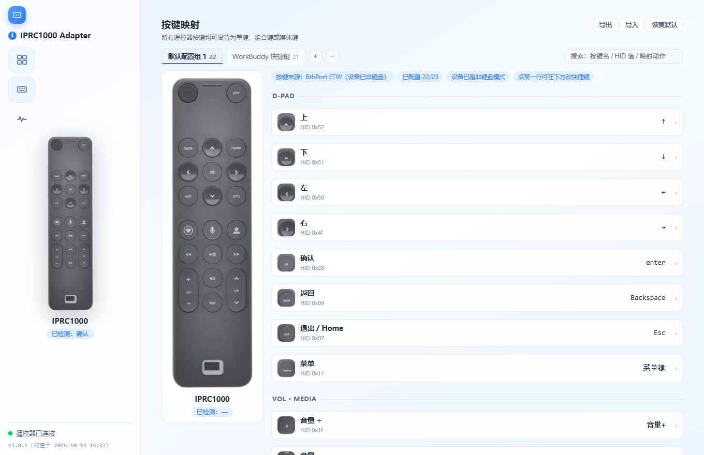
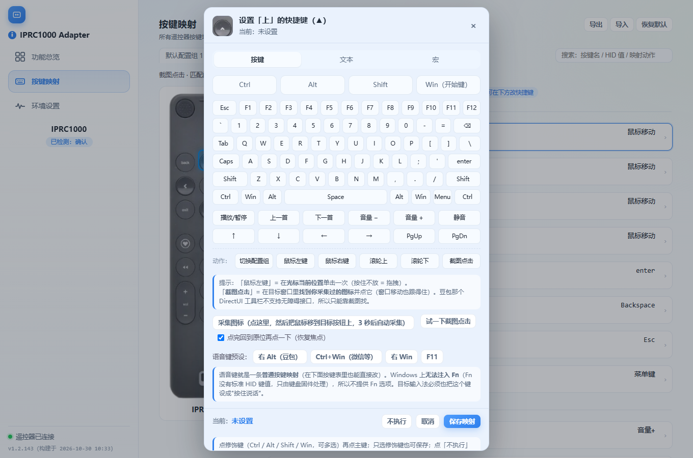
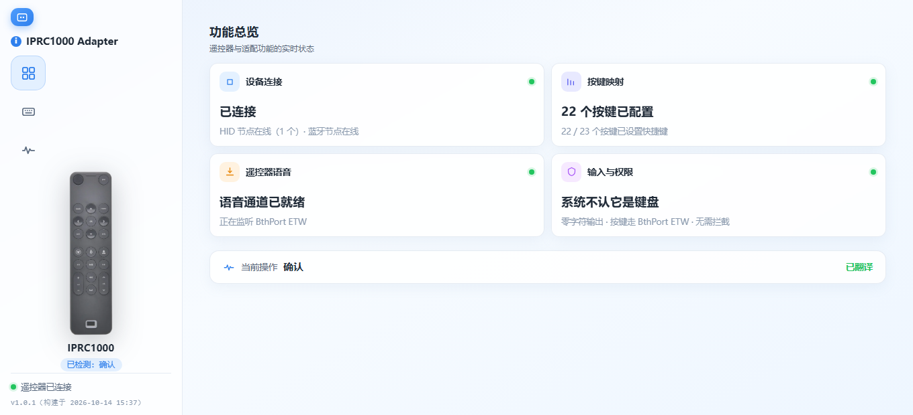
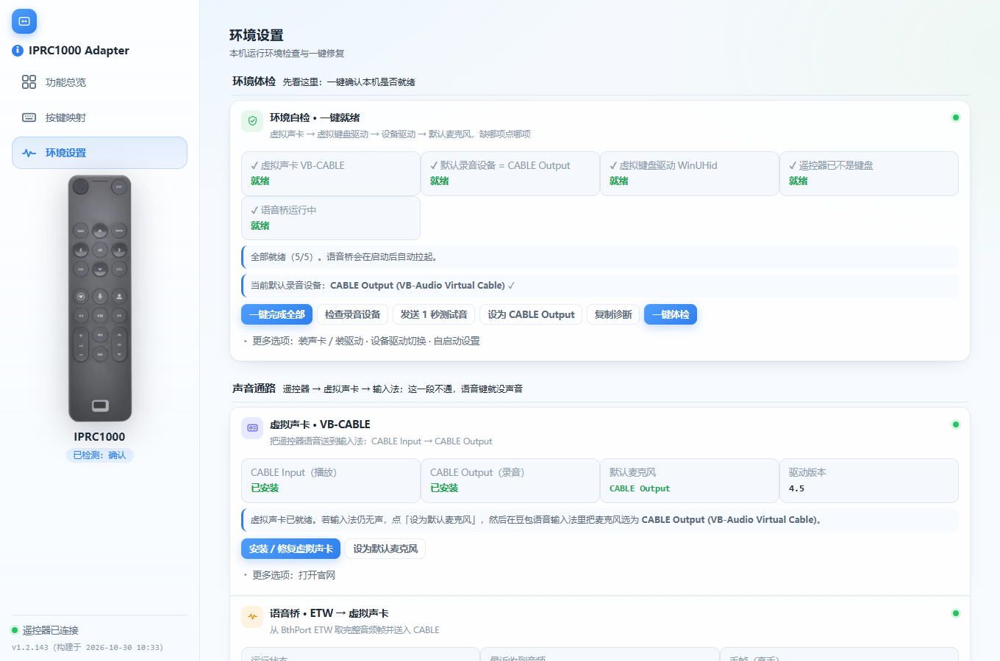

# IPRC1000 遥控器适配器

把 **Bluetooth 语音遥控器**（IPRC1000 / BCM20734）变成 Windows 的**语音输入 + 快捷键盘**。

- 按住遥控器【语音键】说话 → 自动注入 **右 Alt（按住不放）** → 豆包输入法的「长按模式」开始收音
- 方向 / 确认 / 返回 / 音量 等键 → 注入对应快捷键（可自由映射，支持组合键、媒体键）
- 最底部【方块键】→ **循环切换配置组**；内置「Windows 日常」与「WorkBuddy 快捷键」两组

---

## 界面

**按键映射** —— 左侧遥控器实体图（点键高亮），右侧每行是该键的缩略图 + 当前映射：



**屏幕键盘改键** —— 点任意一行弹出，支持修饰键组合；语音键另有豆包 / 微信输入法一键预设：



| 功能总览 | 环境设置（缺哪项点哪项）|
|---|---|
|  |  |

---

## 功能

| 功能 | 说明 |
|---|---|
| **语音输入** | 按住 🎤 注入右 Alt（按住不放），松手即释放 —— 适配豆包等输入法的「长按说话」|
| **全键可改** | 23 个按键都能改：单键 / 组合键（Ctrl·Alt·Shift·Win）/ 媒体键 / 不执行 |
| **多组配置** | 内置两组，【方块键】循环切换；支持新建 / 重命名 / 删除 / 搜索 / 导出 / 导入 |
| **环境一键就绪** | 虚拟声卡、虚拟键盘驱动、设备驱动、默认麦克风，缺哪项点哪项 |
| **开机自启** | 可设为开机启动并直接进托盘 |
| **卡键防护** | 退出释放 + 启动自愈 + 独立守卫脚本，避免注入的键被锁在「按下」|

---

## 目录结构

```
iprc1000_gui_dotnet/       主程序（.NET 8 + WinForms + WebView2 界面）
  ├─ Backend / KeyFilter / Keymaps / Keys / Env / WinUhidInjector / EtwKeySource ...
  ├─ ui/                   界面（HTML/CSS/JS + 遥控器图片）
  └─ assets/               运行期资源（第三方二进制见下方"准备"）
tools/
  ├─ etw_consumer/         语音桥（Rust）：从 BthPort ETW 读按键与音频
  ├─ SetHidDriver/         设备驱动切换工具（键盘 ↔ 普通 HID）
  ├─ 一键部署.ps1           首次部署：驱动 + 设备绑定 + 声卡 + 启动
  ├─ stuck_key_guard.py    独立卡键守卫（App 没跑也能救）
  ├─ Run-Guard.cmd         上面那个守卫的提权启动器
  ├─ check_stuck_key.py    卡键检查
  ├─ package.py            一键打包 + 包内容校验
  └─ docs/                 SOP 与遥控器说明书
```

---

## 准备

### 运行依赖

- Windows 10/11 x64
- **.NET 8 Desktop Runtime**
- **WebView2 Runtime**（Win10/11 一般自带）
- 管理员权限（ETW 抓包 + 驱动安装）

### 需要自行获取的第三方组件

仓库**不包含**以下二进制（体积大 / 许可限制），请自行下载放到 `iprc1000_gui_dotnet/assets/`：

| 组件 | 用途 | 从哪来 |
|---|---|---|
| **WinUHid** | 虚拟 HID 键盘（注入右 Alt 说话、系统热键必需）| WinUHid 项目发布页 |
| **VB-CABLE** | 虚拟声卡（音频回环）| VB-Audio 官网 |
| `etw_consumer.exe` | 语音桥 | 本项目自建：`cd tools/etw_consumer && cargo build --release` |

> 官方的**发布包 zip** 里已内置这些组件，`tools/一键部署.ps1` 会自动安装它们。

---

## 构建

```powershell
# 语音桥（Rust）
cd tools/etw_consumer
cargo build --release
copy target\release\etw_consumer.exe ..\..\iprc1000_gui_dotnet\assets\

# 主程序（.NET 8）
cd iprc1000_gui_dotnet
dotnet publish -c Release -r win-x64 --self-contained false -p:PublishSingleFile=true -o publish
```

## 部署

```powershell
# 右键「以 PowerShell 运行」（会自己提权）
tools\一键部署.ps1
```

脚本依次完成：① WinUHid 驱动 ② 设备驱动绑定（kbdhid → HID-compliant device）
③ VB-CABLE 声卡 ④ 启动主程序（其余自动化由程序完成）

详细步骤与排障见 **[`tools/docs/SOP-部署与使用.md`](tools/docs/SOP-部署与使用.md)**，
键位表见 **[`tools/docs/遥控器按键说明.md`](tools/docs/遥控器按键说明.md)**，
版本变更见 **[`CHANGELOG.md`](CHANGELOG.md)**。

---

## 使用

| 操作 | 效果 |
|---|---|
| 按住 🎤 | 语音输入（豆包长按模式）|
| 按 ▭ | 循环切换配置组（默认组 ↔ WorkBuddy 快捷键）|
| 「按键映射」页 | 左侧遥控器高亮 + 右侧每行按键截图；点一行弹出**屏幕键盘**改键 |
| 配置组 Tab | `+` 复制新建 · 双击重命名 · `−` 删除 · 搜索框过滤 · 导出 / 导入 |

改键支持：单键、组合键（Ctrl/Alt/Shift/Win）、媒体键、以及「不执行」。
语音键另有 **豆包（右 Alt）** 与 **微信输入法（Ctrl+Win）** 两个一键预设。

---

## 已知限制

- **按键有约 10~200 ms 延迟**（活跃时约 13 ms，空闲约 200 ms）—— ETW 刷新周期的限制。
- 需要**管理员权限**。
- 仓库不含第三方驱动/声卡二进制，首次部署需按上文准备。

## License

本项目以 **MIT** 发布，见 [`LICENSE`](LICENSE)。

发布包内置了若干第三方组件（WinUHid、VB-CABLE 等），各自的版权与许可见
**[`THIRD-PARTY-NOTICES.md`](THIRD-PARTY-NOTICES.md)** —— 其中 WinUHid 为 MIT 许可，
该声明文件按许可要求随包一同分发。
